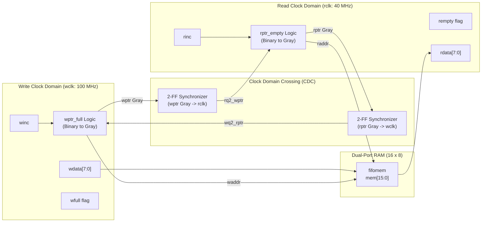

# Dual-Clock Asynchronous FIFO with CDC Protection

A synthesizable, parameterized dual-clock asynchronous FIFO buffer implemented in Verilog HDL. Designed to facilitate safe, zero-loss data streaming across independent asynchronous clock domains using Clock Domain Crossing (CDC) safeguards.

---

## Architecture Overview



---

## Key Hardware Design Features

1. **Dual Independent Clock Domains:** Operates safely when write clock (`wclk = 100 MHz`) and read clock (`rclk = 40 MHz`) have asynchronous, unrelated frequencies.
2. **Clock Domain Crossing (CDC) Protection:** Implements 2-stage D-Flip-Flop synchronizers (`sync_2ff.v`) to suppress metastability and maximize Mean Time Between Failures (MTBF).
3. **Gray Code Pointer Encoding:** Read and write pointers are converted from binary to Gray code before crossing domains (`G = B ^ (B >> 1)`), guaranteeing that **only 1 bit toggles per increment cycle**, completely eliminating multi-bit CDC bus skews.
4. **Look-Ahead Full and Empty Generation:**
   - **`rempty`:** Evaluated in the read clock domain by comparing the Gray-coded read pointer with the synchronized write pointer.
   - **`wfull`:** Evaluated in the write clock domain by comparing the Gray-coded write pointer with the synchronized read pointer with inverted MSB and 2nd MSB.
5. **Dual-Port Memory Array:** Prevents memory contention and supports simultaneous write and read operations.

---

## Directory Structure

```
├── async_fifo.v      # Top-level module integrating memory, sync, and pointers
├── fifomem.v         # Dual-port RAM storage array
├── sync_2ff.v        # 2-stage D-Flip-Flop CDC synchronizer
├── rptr_empty.v      # Read pointer generation and empty detection logic
├── wptr_full.v       # Write pointer generation and full detection logic
└── tb_async_fifo.v   # Self-checking testbench with CDC verification
```

---

## Simulation & Verification

The design is simulated and verified using **Icarus Verilog**:

```bash
# Compile and run simulation
iverilog -o sim_fifo tb_async_fifo.v async_fifo.v fifomem.v sync_2ff.v rptr_empty.v wptr_full.v
vvp sim_fifo
```

### Simulation Output
```text
------------------------------------------------------------
   STARTING DUAL-CLOCK ASYNCHRONOUS FIFO TESTBENCH          
------------------------------------------------------------
[PASS] Reset verified: FIFO is correctly EMPTY and NOT FULL.
>>> Starting Burst Write to fill FIFO (16 elements)...
[PASS] FIFO correctly flagged FULL after 16 consecutive writes.
[PASS] Overflow protection verified: write suppressed when full.
>>> Starting Burst Read to empty FIFO...
[PASS] FIFO correctly flagged EMPTY. All 16 data values verified perfectly.
------------------------------------------------------------
   ALL ASYNCHRONOUS FIFO TESTS PASSED WITH ZERO ERRORS!    
------------------------------------------------------------
```

Waveforms can be inspected via GTKWave:
```bash
gtkwave async_fifo.vcd
```
